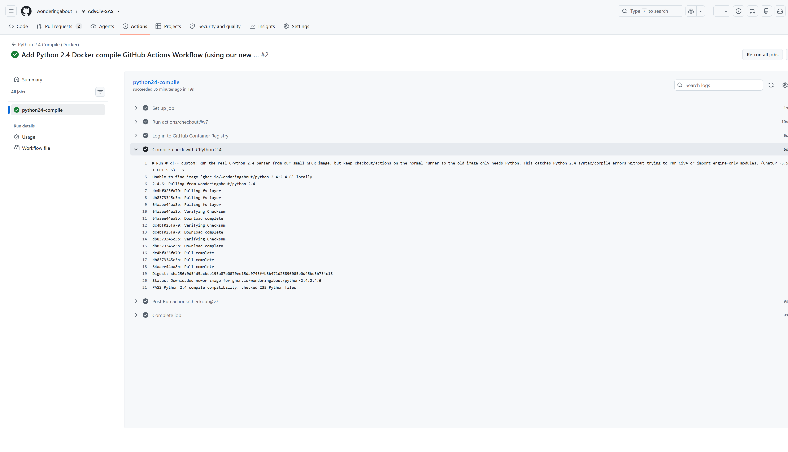
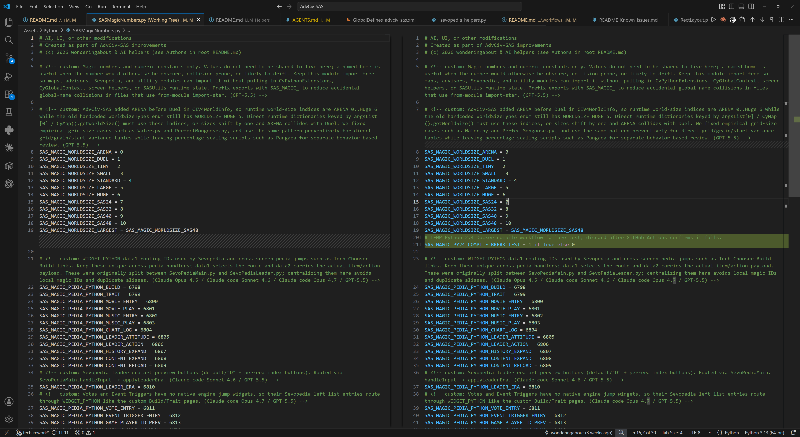
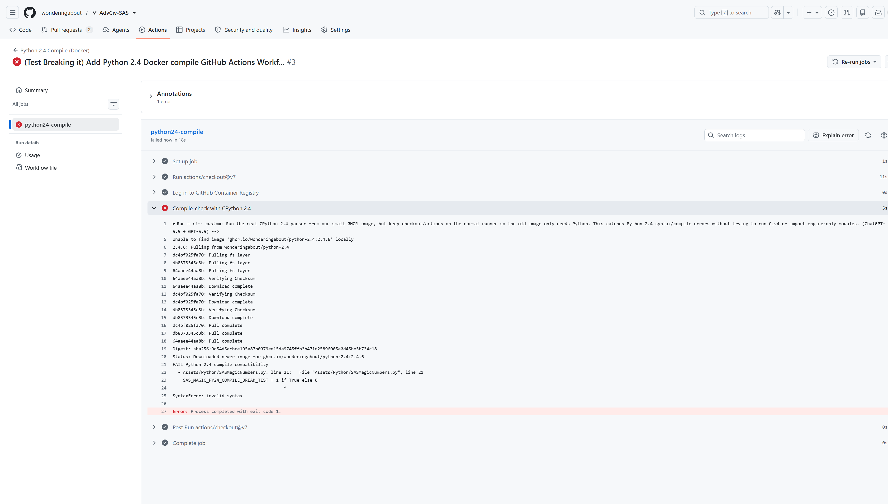

# python-2.4-docker

Docker image build recipe for CPython 2.4.6, mainly for legacy Python 2.4 syntax/compile checks.

## Purpose

This repository builds a small Docker image and a standalone Linux runtime containing CPython 2.4.6.

The intended use case is checking whether old Python code can still be parsed/compiled by Python 2.4. This is useful for legacy embedded-Python projects such as games (e.g., [AdvCiv-SAS](https://github.com/wonderingabout/AdvCiv-SAS)), tools, or applications that still depend on Python 2.4.

Modern linting tools such as Ruff are useful, but passing their checks or a Python 3 compile does not prove Python 2.4 compatibility. For example, `value = a if condition else b` is valid in newer Python but fails in Python 2.4.

When we started this repository, we had not yet installed Python 2.4 on our Windows development machine for our usual local Codex agents.

So we created the Docker image and used it in AdvCiv-SAS's GitHub CI to run real Python 2.4 checks on pushed source. These CI checks run on GitHub's Linux machines, independently of any Python installation on our Windows machine.

But later, we noticed that Python 2.4 could also be installed locally, so we installed it on our Windows machine at `C:\Python24\python.exe`. Our usual local Codex agents, or other local agents using that machine, can now run the checks directly too.

Soon after, we noticed the remaining gap: external web agents such as ChatGPT review AdvCiv-SAS through uploaded [light-source ZIPs](https://github.com/wonderingabout/AdvCiv-SAS/blob/main/README.md#light-source-zip) rather than our local Git checkout, and cannot access our installed Python.

The ChatGPT environment inspected in October 2026 ran Linux x86-64 without Python 2.4, so it could not run the real validation checks. Other or future agent environments may differ.

So this repository also prepares a downloadable Linux Python 2.4 archive for external use. Including it in a source handoff lets those agents run the checks without a local Git clone or a separate Python installation, as explained below.

This image is not meant for modern Python development.

## Image

Published GHCR image:

```text
ghcr.io/wonderingabout/python-2.4:2.4.6
```

Other moving tags:

```text
ghcr.io/wonderingabout/python-2.4:latest
ghcr.io/wonderingabout/python-2.4:YYYY-MM
```

Example:

```bash
docker pull ghcr.io/wonderingabout/python-2.4:2.4.6
docker run --rm ghcr.io/wonderingabout/python-2.4:2.4.6 python -V
```

Expected version:

```text
Python 2.4.6
```

For long-term CI use, prefer pinning the image by digest instead of using `latest` or another moving tag.

## Build automation

The existing [`image-autobuild.yml`](.github/workflows/image-autobuild.yml) builds and publishes the Docker image when:

- Run manually with `workflow_dispatch`
- `Dockerfile` or `.github/workflows/image-autobuild.yml` changes on `main`
- The monthly schedule runs at 03:37 UTC on day 1 of each month

The monthly image rebuild confirms that the recipe still works and refreshes moving image tags. Its existing triggers and publication remain separate from standalone runtime packaging.

The independent [`runtime-autobuild.yml`](.github/workflows/runtime-autobuild.yml) builds and tests the downloadable runtime manually, on changes to its workflow/Dockerfile, and monthly at 03:47 UTC on day 1.

Only the repository default branch publishes runtime releases; other branches validate without publishing. Each workflow builds its own image so a failure in archive packaging or release upload cannot block GHCR image updates.

The image compile smoke test now raises compilation errors explicitly: Python 2.4's `-m py_compile` was reproduced printing a syntax error while returning exit code zero.

## Standalone Linux runtime

### Why maintain the runtime here?

We considered keeping the interpreter package directly in [AdvCiv-SAS](https://github.com/wonderingabout/AdvCiv-SAS), which would simplify SAS's own packaging.

However, [AdvCiv-SAS-NIF-Gallery (Female Leaderheads)](https://github.com/wonderingabout/AdvCiv-SAS-NIF-Gallery) and other mods or tools would then have to, tediously or redundantly, either maintain their own copy, duplicating hosting and update work, or depend on the SAS mod repository for a general-purpose tool.

So we chose a shared standalone Linux package maintained here, alongside the Docker recipe:

- This `python-2.4-docker` GitHub repository is now responsible for building, testing, updating and publishing the Linux Python 2.4 package, rather than repeating that work in every project.
- Projects such as AdvCiv-SAS, AdvCiv-SAS-NIF-Gallery, other Civ4 mods, or even projects unrelated to Civ4 can then provide this package to their external review agents.
  - For example, if AdvCiv-SAS includes it in a light-source ZIP, external web ChatGPT can run real Python 2.4 checks on the uploaded source even without a local Git clone or an installed Python 2.4, unlike our usual local Codex setup described above.

### Package and platform

The standalone runtime workflow exports CPython 2.4.6, its standard library and upstream license as `python-2.4.6-linux-x86_64-debian-bookworm.tar.gz`.

To use it, extract the archive and set `PYTHONHOME` to the extracted `python-2.4.6` directory. This tells Python where to find its bundled standard-library files.

- Standalone archive: Linux x86-64 with a Debian bookworm/glibc baseline; it is not a Windows executable or a promise of universal Linux compatibility.
- Windows: this repository does not provide a native Windows interpreter package. Windows hosts can use the Docker image through a Linux-container backend, or use a separately installed Windows Python 2.4 interpreter, as our usual local Codex agents do.
- Before publishing, the workflow checks that the packaged Python runs outside Docker, accepts valid Python 2.4 code, and rejects newer syntax such as `a if condition else b`.

### Automatic updates

The small [current-runtime manifest](https://github.com/wonderingabout/python-2.4-docker/releases/download/runtime-linux-x86_64-bookworm/runtime-manifest.json) identifies the tested archive URL, exact byte size, SHA-256, Python/platform versions and build commit.

- Consumers fetch the manifest and compare its SHA-256 with their verified local package, downloading the archive only when needed.
- Each published archive lives in its own checksum-named release; published package bytes are not overwritten, and previous packages remain available.
- The moving channel release contains only `runtime-manifest.json`, updated after the complete version release is published.
  - This channel must permit release-asset replacement; it is deliberately separate from retained version packages.
- Rebuilds can change package bytes even when the Python version stays 2.4.6. Archive timestamps are normalized, but compiler output is not promised to be reproducible.
- A consumer may retain its previously verified local package if the manifest is temporarily unavailable, clearly reporting that it could not check for updates. That fallback belongs in the consumer helper.

Git tracks the build recipe and workflow; downloadable interpreter packages remain release assets. The first package size will be measurable after the first successful GitHub build.

## Downstream validation example

This image was tested from an AdvCiv-SAS GitHub Actions workflow by running CPython 2.4 against the repository's Python files.

A [normal run passed](https://github.com/wonderingabout/AdvCiv-SAS/actions/runs/27897105743/job/82550600175):

```text
PASS Python 2.4 compile compatibility: checked 235 Python files
```

A deliberate break test was then added to one file using Python 2.5+ conditional-expression syntax:

```python
SAS_MAGIC_PY24_COMPILE_BREAK_TEST = 1 if True else 0
```

The [workflow failed as expected](https://github.com/wonderingabout/AdvCiv-SAS/actions/runs/27897204427) with a Python 2.4 syntax error:

```text
FAIL Python 2.4 compile compatibility
SyntaxError: invalid syntax
```

This confirms that the image is useful for catching accidental Python syntax that is too new for Python 2.4. It only checks parser/compile compatibility; it does not test runtime imports from an embedded application such as Civ4's `CvPythonExtensions`.

</img>
</img>
</img>

## Build locally

```bash
docker build -t python-2.4:local .
docker run --rm python-2.4:local python -V
```

## Licensing

- Repository-original build tooling is licensed under [GNU GPLv3](LICENSE).
- CPython is built from the official Python.org source archive and retains its own [upstream license](https://www.python.org/download/releases/2.4.6/license/).
  - The Dockerfile copies that license into `python-2.4.6/LICENSE.txt`, preserving it in both the image and standalone archive.
- Other third-party material keeps its own applicable terms and notices; this repository's GPLv3 does not override them.
- Running this interpreter to check another project does not change that project's license. For example, checking AdvCiv-SAS does not make its source GPLv3 or remove its reuse restrictions.

## LLM Credits (ChatGPT and Codex)

- GPT-5.5 (on Codex)
- ChatGPT-5.5
- ChatGPT-5.6-Sol (initial standalone runtime handoff)
- GPT-6.1-Sol (on Codex; runtime validation fixes and automatic update channel)
